<div align="center">

# 🔁 reflow

### Pipeline de migração assistida por IA de robôs legados (A360 · Python · .NET) para Power Automate Desktop, com checkpoint humano obrigatório

[](https://www.python.org/downloads/)
[](https://docs.astral.sh/uv/)
[](https://docs.claude.com/en/docs/claude-code/overview)
[](https://opencode.ai)
[](https://learn.microsoft.com/power-automate/desktop-flows/introduction)

[](#-arquitetura)
[](#-arquitetura)
[](#-arquitetura)
[](#-segurança)
[](#-arquitetura)

[Sobre](#-sobre-o-projeto) •
[Arquitetura](#-arquitetura) •
[Pré-requisitos](#️-pré-requisitos-windows) •
[Instalação](#-instalação) •
[Uso](#️-uso) •
[Segurança](#-segurança) •
[Como estender](#-como-estender) •
[Dashboard local](#️-dashboard-local-opcional) •
[Troubleshooting](#-troubleshooting) •
[Autor](#-autor)

---

</div>

## 📖 Sobre o Projeto

**reflow** é um pipeline de migração assistida por IA que pega robôs legados
— **Automation Anywhere A360** (prioridade), **Python** ou **.NET C#/VB.NET**
— e os leva até um `Main.robin` pronto para colar no designer do **Power
Automate Desktop (PAD)**. A extração dos fatos é 100% determinística (sem
LLM, sem rede, sem rodar o legado); a documentação, classificação e conversão
usam agents de IA especializados, um por fase; e nenhum flow chega ao PAD sem
passar por um **checkpoint humano** explícito.

### 🧩 O problema que isto resolve

O código gerado pelo PAD é uma "caixa fechada": não existe import de binário
nem de JSON, só colar (Ctrl+V) um texto Robin (`Main.robin`) no designer. A
versão anterior disso era um prompt monolítico só no Claude Code — sem
reaproveitamento, com analistas recortando pedaço de prompt à mão. Este
projeto quebra esse prompt em skills e agents especializados, cada um com
entrada/saída e permissão próprias, e adiciona o que faltava: extração A360
em lote, diagrama de arquitetura por projeto, uma tabela verdade A360→PAD
(Robin tem pouquíssima documentação pública), testes de regressão/integração,
e uma classificação que sabe dizer quando RPA **não** é a resposta.

## 🏗️ Arquitetura


Este é o diagrama da fase final, desenhado na reunião de 16/10/2026
(fonte editável: `diagram - FINAL com AGENTS.drawio`). Ele mostra o pipeline
de ponta a ponta, da esquerda para a direita:

1. **Entradas** (`input/<projeto>/`) — export A360, código Python ou binário
   .NET C#/VB.
2. **Fase 1, Python determinístico, sem LLM** — `cli.py extract` roda os
   `extractors/` e grava `01-inventory/inventory.json`: fatos crus, por
   `arquivo:linha`, com secrets já mascarados.
3. **Claude Code / opencode** — a skill orquestradora `/reflow` encadeia
   `reflow-document` → `reflow-classify` → **checkpoint humano** (só
   `PAD`/`PARTIAL` seguem; `NOT_PAD` encerra ali) → `reflow-convert` →
   `reflow-test`. Cada seta é uma fase com um agent isolado, que só enxerga a
   própria subpasta de saída.
4. **`reference/` editável** — a classificação e a conversão consultam
   `classification-rubric.md`, `robin-conventions.md`, a whitelist
   `robin-actions.md` e a tabela verdade A360 → PAD, todas versionadas e
   revisáveis por humano.
5. **Camada LLM** — hoje a IAra (LLM interno do Itaú); o contorno tracejado
   verde é o "Plano B" ainda pendente, um harness próprio reaproveitando as
   mesmas skills/agents caso o acesso ao Claude Code se perca.
6. **Validação no PAD** (laranja, fora deste repositório) — o analista cola o
   `Main.robin` gerado no designer do Power Automate Desktop, roda o flow de
   teste, registra PASS/FAIL e só então os testes de regressão/integração e
   os ajustes de borda entram, antes de ir para produção.

Em resumo, **o que este projeto faz**: pega um robô legado (A360, Python ou
.NET), extrai os fatos dele sem rodar nada e sem LLM, documenta e classifica
com agents especializados, exige aprovação humana antes de qualquer conversão,
gera um `Main.robin` pronto para colar no PAD e já entrega o flow de teste
junto — sempre com secrets mascarados e sem nenhuma chamada de rede saindo do
Python determinístico.

Versão em texto do mesmo diagrama, em Mermaid (útil para diffs e leitores que
não carregam a imagem):

```mermaid
flowchart LR
    subgraph INP["Entradas · input/&lt;projeto&gt;/"]
        I1["Export A360<br/>JSON / .zip · lote de exemplos (Community Edition)"]
        I2["Python"]
        I3[".NET C# / VB<br/>binários: decompilar com ILSpy"]
    end

    subgraph F1["Fase 1 · Python determinístico (sem LLM)"]
        C1["cli.py extract<br/>/reflow-extract · &lt;projeto&gt; | --all"]
        C2["extractors/<br/>a360 · python · dotnet"]
        C3["01-inventory/inventory.json<br/>fatos arquivo:linha · secrets mascarados"]
        C1 --> C2 --> C3
    end

    subgraph CC["Claude Code / opencode · um agent isolado por fase"]
        ORC["/reflow · skill orquestradora:<br/>extract → document → classify → checkpoint → convert → test<br/>(retoma de onde parou)"]
        D["2 · /reflow-document<br/>agent reflow-documenter<br/>→ 02-docs/ + diagrama de arquitetura"]
        CL["3 · /reflow-classify<br/>agent reflow-classifier<br/>→ PAD · PARTIAL · NOT_PAD"]
        CK{"Checkpoint humano<br/>NOT_PAD encerra"}
        CV["4 · /reflow-convert<br/>agent reflow-pad-converter<br/>→ 04-pad/&lt;flow&gt;/Main.robin"]
        TS["5 · /reflow-test<br/>agent reflow-pad-tester<br/>→ 05-test/ flow PASS/FAIL"]
        D --> CL --> CK
        CK -->|PAD / PARTIAL| CV --> TS
    end

    subgraph REF["reference/ · editável"]
        R1["classification-rubric.md"]
        R2["robin-conventions.md"]
        R3["robin-actions.md<br/>whitelist Robin"]
        R4["Tabela verdade<br/>A360 → ação PAD"]
    end

    subgraph LLMC["Camada LLM"]
        IA["IAra<br/>LLM interno do Itaú"]
        HB["Plano B: agente próprio<br/>harness reaproveita as mesmas skills e agents"]
        HB -.-> IA
    end

    subgraph VAL["Validação no PAD"]
        V1["Analista cola o Main.robin no PAD"]
        V2["PAD executa o flow<br/>Edge + extensão Power Automate"]
        V3["Flow de teste<br/>05-test · PASS/FAIL no log"]
        V4["Testes de regressão e integração automatizados"]
        V5["Analistas ajustam<br/>casos de borda e controle"]
        V1 --> V2 --> V3 --> V4 --> V5
    end

    INP --> C1
    C3 -->|inventário| D
    REF -.->|consulta| CC
    CC -.->|proxy| IA
    CV -->|Main.robin| V1
    TS -->|teste .robin| V3

    classDef evolucao stroke:#2D7600,stroke-width:2px,stroke-dasharray: 5 5;
    class R4,HB,V4 evolucao;
```



Contorno verde tracejado = evolução pedida pelo Augusto na reunião (R1–R8) ·
tracejado cinza = consulta ou chamada ao LLM · laranja no original = execução
no Power Automate Desktop (etapas `V1`–`V5`). Todos esses itens já existem
hoje neste repositório — ver a tabela fase → skill → agent → artefato abaixo
e [`docs/historico.md`](docs/historico.md) para a validação real de ponta a
ponta já executada (`quote-scraper` e `a360-browser-rest`).

Diagrama complementar (componentes, fronteiras de confiança, onde o LLM
entra): [`docs/architecture.md`](docs/architecture.md).

| Fase | Skill | Agent | Artefato |
| --- | --- | --- | --- |
| 1 | `reflow-extract` | — (determinístico) | `00-manifest.json`, `01-inventory/inventory.json` |
| 2 | `reflow-document` | `reflow-documenter` | `02-docs/` (inclui `architecture.md`) |
| 3 | `reflow-classify` | `reflow-classifier` | `03-classification/classification.md` |
| 3b · QA | `reflow-classify-review` | `reflow-classification-reviewer` | `03-classification/review.md` |
| checkpoint | — | — | `00-manifest.json` → `checkpoint` |
| 4 | `reflow-convert` | `reflow-pad-converter` | `04-pad/<flow>/Main.robin` |
| 4b · QA | `reflow-convert-review` | `reflow-robin-reviewer` | `04-pad/<flow>/review.md` |
| 5 | `reflow-test` | `reflow-pad-tester` | `05-test/test_<flow>/` |
| auxiliar | `reflow-truth-table` | `reflow-truth-table-curator` | `reference/a360-to-pad.md` |
| orquestrador | `reflow` | aciona todos acima | o pipeline completo, um projeto por vez |

As fases `3b` e `4b` são uma **segunda opinião independente** adicionada
depois da reunião de 16/10/2026 (por isso não aparecem no diagrama da seção
anterior, que é o retrato exato do que foi combinado naquela reunião): um
segundo agent reclassifica/audita sem ver o raciocínio do primeiro, grava só
o próprio `review.md` ao lado do artefato original — nunca o sobrescreve — e
nunca aprova nem bloqueia sozinho. O checkpoint humano continua sendo quem
decide; essas fases só dão a ele mais informação antes de decidir (ver
ADR-014 e ADR-015 em [`docs/decisions.md`](docs/decisions.md)).

**Python determinístico × LLM:** `reflow/` (o pacote Python) só lê e faz
parse — AST para Python, JSON para A360, heurística por linha para .NET.
Zero rede, zero dependência de runtime, zero chamada a LLM. Só os agents
(fases 2–5, as duas revisões 3b/4b, e a curadoria da tabela verdade) usam um
LLM, e só recebem o inventário já mascarado — nunca o `input/` bruto, além
de trechos já citados
por `arquivo:linha`.

## ⚙️ Pré-requisitos (Windows)

| Ferramenta | Para quê | Link |
| --- | --- | --- |
| Python ≥ 3.12 | Runtime do `reflow/` (via uv) | https://www.python.org/downloads/ |
| uv | Gerenciar o ambiente e as dependências de dev | https://docs.astral.sh/uv/ |
| Git | Versionamento e o hook de pre-commit | https://git-scm.com/downloads |
| opencode (harness principal) | Rodar skills/agents com um LLM | https://opencode.ai |
| Claude Code (harness alternativo/plano B) | Mesmas skills/agents, outro harness | https://docs.claude.com/en/docs/claude-code/overview |
| GitHub Copilot Chat (harness alternativo/plano C, opcional) | Mesmos agents via `.github/prompts/`/`.github/chatmodes/` | https://docs.github.com/copilot |
| Power Automate Desktop | Colar e rodar o `Main.robin` gerado | https://learn.microsoft.com/power-automate/desktop-flows/introduction |
| Microsoft Edge + extensão Power Automate | O PAD depende do Edge para automação web | https://www.microsoft.com/edge |
| Acesso à IAra (ou outro provider compatível OpenAI) | LLM usado pelos agents | solicitar ao time responsável — sem URL pública |
| ILSpy (opcional) | Decompilar binário .NET antes de extrair | https://github.com/icsharpcode/ILSpy/releases |
| Automation Anywhere Community Edition (opcional) | Gerar exports A360 reais para testar | https://www.automationanywhere.com/products/community-edition |
| PowerShell 7 + Ollama local (opcional) | Dashboard local de teste (`dashboard/`) | https://ollama.com/download |

## 🚀 Instalação

```powershell
git clone <url-do-seu-remoto> reflow
cd reflow
uv sync
git config core.hooksPath .githooks
copy .env.example .env
# edite .env com IARA_BASE_URL / IARA_API_KEY / IARA_MODEL reais
uv run pytest
```

Dentro do opencode, configure o provider e confirme o modelo:

```
/connect
/models
```

`.env` sozinho não garante nada — o harness (opencode ou Claude Code) precisa
receber essas variáveis no ambiente do processo. Nunca grave chave real em
arquivo versionado; `.env.example` só documenta os nomes.

## 📥 Como obter os exports A360

Hoje este repositório só versiona fixtures sintéticas
(`tests/fixtures/a360/`, `input/quote-scraper/`). Para testar com exports
reais: use o Automation Anywhere Community Edition (tabela de
pré-requisitos) para gerar um export de um bot de teste, ou peça ao time de
operação do Itaú (que já está separando os repositórios a migrar) um export
de um robô simples. Coloque o resultado — pasta ou `.zip` — em
`input/<projeto>/`, com nome em minúsculas, números, hífen ou underscore.

## ▶️ Uso

```powershell
uv run python -m reflow extract <projeto>   # ou --all
uv run python -m reflow report
```

Dentro do opencode ou do Claude Code (mesmas skills, mesmos comandos):

```
/reflow <projeto>        # pipeline completo: extract → document → classify →
                          # checkpoint → convert → test
/reflow                  # vazio = todos os projetos em input/, um por vez
/reflow-extract <projeto>
/reflow-document <projeto>
/reflow-classify <projeto>
/reflow-convert <projeto>   # só depois do checkpoint aprovar
/reflow-test <projeto>
/reflow-truth-table <projeto>
/reflow-report
```

Fases avulsas são úteis quando o contexto fica grande demais para o
orquestrador completo (ver `docs/runbook.md`). `/reflow` retoma de onde um
projeto parou — olha `00-manifest.json` antes de refazer uma fase já feita.

## 📂 Saídas (`output/<projeto>/`)

| Pasta | Conteúdo |
| --- | --- |
| `00-manifest.json` | hashes SHA256 das entradas, versão do reflow, data, `checkpoint`, `stale_phases` |
| `01-inventory/inventory.json` | fatos mascarados, com `arquivo:linha` |
| `02-docs/` | documentação de negócio/técnica + `architecture.md` (Mermaid) |
| `03-classification/classification.md` | veredito `PAD`/`PARTIAL`/`NOT_PAD`, casos de uso, alertas |
| `04-pad/<flow>/` | `Main.robin`, `README.md`, `notas-conversao.md` |
| `05-test/test_<flow>/` | `Main.robin` de teste + 3–5 cenários `CT-xx`, sem PASS/FAIL ainda |

`NOT_PAD` encerra o projeto depois de `02-docs`/`03-classification` — não há
`04-pad` nem `05-test` para ele.

## 📋 Do flow para o PAD

1. Abra o PAD, crie um novo flow desktop (nome livre).
2. Abra `output/<projeto>/04-pad/<flow>/Main.robin`, selecione tudo, copie.
3. No designer do PAD, clique no corpo do `Main` e cole (Ctrl+V).
4. Rode o flow. Saída esperada sempre em `C:\Users\Public\Documents\`.
5. Repita com `05-test/test_<flow>/Main.robin` para o flow de teste; leia os
   cenários `CT-xx` no `README.md` ao lado e registre manualmente
   PASS/FAIL — o pipeline nunca escreve isso por você.

## ✅ Tabela verdade e whitelist

[`reference/robin-actions.md`](reference/robin-actions.md) (whitelist, por
módulo) e [`reference/a360-to-pad.md`](reference/a360-to-pad.md) (A360 → PAD)
nascem conservadoras — toda ação começa `[não validado]`. Para promover:

1. Monte a ação manualmente no designer do PAD e confirme que funciona.
2. Copie o texto gerado (Ctrl+C) e cole no lugar do placeholder em
   `robin-actions.md`.
3. Troque o status para `[validado PAD: rodou]`.
4. Nunca edite uma linha já `validado` sem revisão humana.

Comando desconhecido na extração (`unknown_commands`) entra em
`a360-to-pad.md` como `pendente de classificação` via `/reflow-truth-table`
— nunca com uma ação já suposta.

## 🔒 Segurança

Resumo — detalhe completo em [`SECURITY.md`](SECURITY.md): secrets e PII são
mascarados antes de qualquer saída (`security/masking.py`), inclusive por
nome de chave em estrutura (JSON) e cabeçalho HTTP de portador (`Authorization`
com token `Bearer`);
`reflow scan` varre a working tree, `reflow scan --staged` varre o índice do
Git (o que o hook usa), e nenhum dos dois ecoa o valor real; ZIP é extraído
membro a membro com limite de tamanho e quantidade, e também recusa nome
reservado do Windows, Alternate Data Stream e colisão case-insensitive
(`security/safe_zip.py`); um projeto em `input/` com symlink/junction é
recusado por inteiro (`security/paths.py`), nunca seguido; o legado nunca é
executado; cada agent só edita a própria subpasta de fase, sem bash e sem
rede; `input/` fica fora do Git; chave de LLM só por variável de ambiente.
O hook de pre-commit roda `scan --staged` e `lint-robin` de
verdade — não é decorativo.

## 🛟 Plano B: opencode, Claude Code e Copilot

Três harnesses, uma só evolução: o que entra num, entra nos outros dois na
mesma sessão de trabalho — nunca um fica para trás. As mesmas skills
(`.claude/skills/`) são lidas nativamente por Claude Code e opencode; o
Copilot as acessa via `.github/prompts/<nome>.prompt.md`, um ponteiro de uma
linha para a `SKILL.md` correspondente (escrito à mão, já que é só um
redirecionamento).

Os agents têm formato diferente por harness, mas uma única fonte da
verdade: `.opencode/agents/*.md`. `.claude/agents/*.md` e
`.github/chatmodes/*.chatmode.md` são **gerados** — nunca editar à mão.
Depois de mudar (ou criar) um agent:

```powershell
uv run python scripts/sync_agents.py
uv run python scripts/sync_copilot.py
uv run pytest tests/unit/test_sync_agents.py tests/unit/test_copilot.py
```

**Limite honesto do Copilot**: diferente do OpenCode, o Copilot Chat não tem
motor de permissão por recurso — um chatmode não tem como *impor* tecnicamente
que o modelo só grave o `review.md` da própria fase, só *instruir* isso (por
isso todo `.chatmode.md` gerado carrega um aviso explícito disso, ver
ADR-016). Nenhum destes arquivos foi testado dentro do Copilot de verdade (a
extensão não está disponível neste ambiente); o formato segue a documentação
pública de prompt files/chat modes do Copilot Chat.

Isso existe porque o risco principal apontado na reunião foi perder o acesso
a um harness específico no ambiente do Itaú — o pipeline continua funcionando
em qualquer um dos três sem reescrever nada.

## 🧱 Como estender

- **Novo extractor** (ex.: UiPath): crie `reflow/extractors/<nome>.py`
  implementando o `Protocol` de `extractors/base.py`, registre em
  `extractors/__init__.py` (ordem de prioridade), adicione fixture em
  `tests/fixtures/` e golden em `tests/regression/golden/`.
- **Nova skill**: `.claude/skills/<nome>/SKILL.md`, frontmatter `name` igual
  à pasta (regex `^[a-z0-9]+(-[a-z0-9]+)*$`) e `description`; crie também
  `.opencode/commands/<nome>.md` (wrapper fino) e
  `.github/prompts/<nome>.prompt.md` (ponteiro para a `SKILL.md`); rode
  `uv run pytest tests/unit/test_skills.py tests/unit/test_commands.py tests/unit/test_copilot.py`.
- **Novo agent**: `.opencode/agents/<nome>.md` com permissão mínima (edit só
  na própria subpasta de saída, bash/web/task negados), depois
  `uv run python scripts/sync_agents.py && uv run python scripts/sync_copilot.py`
  — os três harnesses saem sincronizados de uma vez.
- **Nova ação Robin**: adicione em `reference/robin-actions.md` como
  `[não validado]` primeiro; só promova depois de rodar no PAD de verdade.

## 🧪 Testes e qualidade

```powershell
uv run pytest                                    # unit + regression + integration
uv run pytest tests/regression --update-golden   # regrava golden de propósito (revise o diff)
uv run ruff check .
uv run ruff format --check .
```

`tests/unit/` cobre extractors, masking, safe_zip, whitelist, lint Robin,
schema do inventário, frontmatter das skills e paridade dos agents.
`tests/regression/` compara a extração contra golden files — só muda com
`--update-golden` explícito. `tests/integration/` roda a CLI ponta a ponta
sobre as fixtures. O hook de pre-commit roda `scan --staged` (índice do Git,
não a working tree) e `lint-robin` de verdade antes de qualquer commit.

## 🖥️ Dashboard local (opcional)

Painel web local (SSE + HTML/JS/CSS puros, sem framework, tema escuro) para
testar o fluxo com um LLM local, sem tocar `output/` nem o pipeline real de
skills/agents — mesmo espírito do laboratório que já existia num projeto
irmão, agora portado e modernizado.

```powershell
uv run python dashboard/server.py
```

Abra **http://127.0.0.1:8765/** (não abra o HTML como arquivo). Requisitos:
PowerShell 7 (`pwsh`) e Ollama local (`ollama serve` +
`ollama pull llama3.1:8b`) — nada é baixado pelo botão. Zero dependência
Python nova: `dashboard/` usa só stdlib, mesma régua do núcleo `reflow/`.

Escopo honesto: o botão roda um **teste textual isolado** em
`.dashboard-runs/` — extrai de verdade, pede prévia de documentação/
classificação ao LLM local, valida evidência contra o inventário mascarado,
nunca fabrica PASS/FAIL e nunca escreve em `output/`. Não homologa a
migração. Detalhes completos em [`dashboard/README.md`](dashboard/README.md).

Avaliamos usar LangChain aqui e descartamos: o worker PowerShell isolado já
resolve o mesmo problema com uma fronteira de segurança mais forte (a
chamada de rede ao LLM fica fora do processo Python) e zero dependência
pesada nova — ver ADR em [`docs/decisions.md`](docs/decisions.md).

## 🩺 Troubleshooting

Ver [`docs/runbook.md`](docs/runbook.md): origem não suportada, IAra
indisponível, Robin não cola no PAD, ação `[não validado]` falhou, contexto
grande demais.

## 📘 Glossário

| Termo | Significado |
| --- | --- |
| A360 | Automation Anywhere 360, origem prioritária de robôs legados |
| PAD | Power Automate Desktop |
| Robin / `.robin` | Linguagem/formato de texto que o PAD renderiza ao colar no designer |
| IAra | LLM interno do Itaú, acessado via proxy compatível com OpenAI |
| Harness | O programa que chama o LLM (opencode ou Claude Code) — nunca o `reflow/` Python |
| Skill | Instrução compartilhada entre harnesses, em `.claude/skills/` |
| Agent | Subagente com LLM e permissão restrita, uma fase por agent |
| Checkpoint | Aprovação humana obrigatória antes de converter PAD/PARTIAL |
| Tabela verdade | `reference/a360-to-pad.md`: comando A360 → ação PAD |
| Whitelist | `reference/robin-actions.md`: toda ação Robin usada tem que vir daqui |

## 🗺️ Roadmap (pedidos da reunião ainda abertos)

- Validar as primeiras ações da whitelist num PAD de verdade (hoje tudo é
  `[não validado]`).
- Rodar a extração contra exports A360 reais (hoje só fixtures sintéticas).
- Ampliar `reference/a360-to-pad.md` a partir de `unknown_commands` reais.
- Agente próprio (harness `refold`, plano B secundário) reaproveitando as
  mesmas skills/agents — ainda não iniciado.
- Ano de desligamento do datacenter on-prem do Itaú: "a confirmar" (citado de
  forma pouco clara na reunião de 16/10/2026).

---

## 👤 Autor

<div align="center">


### **Cleyber Gomes da Silva**

**AI Scientist / SRE Engineer** · TCS × Itaú Unibanco
**Aluno de MBA em Inteligência Artificial e Big Data** · ICMC / USP
**Mestrando em Engenharia de Software** · CESAR School · **Educação Sciences** · VCCU

📍 João Pessoa, Paraíba, Brasil

[](https://github.com/cleybersilva)
[](https://linkedin.com/in/cleyber-silva)

</div>

### Sobre o autor

AI Scientist / SRE Engineer com experiência em ambientes bancários regulados,
atualmente alocado ao **Itaú Unibanco** via **TCS (Tata Consultancy
Services)**. Simultaneamente, mestrando em **Engenharia de Software** pela
**CESAR School** e doutorando em **Ciências da Educação** pela **VCCU (Veni Creator
Christian University)**, onde também atua como professor, pesquisador e
gestor do VLE (Moodle).

Especialista em **RPA → hyperautomation**, **GitOps**, **Observability** e
**AI aplicada a operações**. O **reflow** nasceu da necessidade real de
migrar robôs A360 legados para o Power Automate Desktop no Itaú sem perder
rastreabilidade nem governança — substituindo um prompt monolítico por
skills e agents especializados, com checkpoint humano obrigatório antes de
qualquer conversão ir para produção.

**Formação simultânea:**
- 🎓 MBA em Inteligência Artificial e Big Data — ICMC/USP
- 🎓 Mestrado em Engenharia de Software — CESAR School
- 🎓 Doutorado em Ciências da Educação — VCCU
- 🎓 Pós-graduações concorrentes em DevOps, Cloud Architecture, SRE e .NET/Azure

---

<div align="center">

### ⭐ Se este projeto foi útil, considere dar uma estrela!

**Feito com ❤️ para tirar a migração RPA → PAD da mão de quem recorta prompt**

---

**reflow** · Skills + Agents + Checkpoint Humano · TCS × Itaú

[⬆ Voltar ao topo](#-reflow)

---

_"A esteira executa o que é determinístico; o humano decide o que é sensível — com o inventário já mascarado na mão."_

© 2026 · Cleyber Gomes da Silva

</div>
