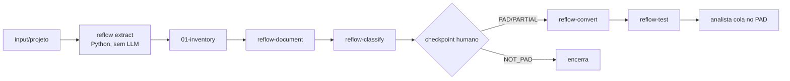

# reflow

Pipeline de migração assistida por IA de robôs legados (Automation Anywhere
A360 — prioridade —, Python e .NET C#/VB.NET) para Power Automate Desktop
(PAD). Extração determinística em Python, documentação/classificação/conversão
por agents com LLM, e validação humana obrigatória antes de qualquer flow
rodar de verdade.

## O problema que isto resolve

O código gerado pelo PAD é uma "caixa fechada": não existe import de binário
nem de JSON, só colar (Ctrl+V) um texto Robin (`Main.robin`) no designer. A
versão anterior disso era um prompt monolítico só no Claude Code — sem
reaproveitamento, com analistas recortando pedaço de prompt à mão. Este
projeto quebra esse prompt em skills e agents especializados, cada um com
entrada/saída e permissão próprias, e adiciona o que faltava: extração A360
em lote, diagrama de arquitetura por projeto, uma tabela verdade A360→PAD
(Robin tem pouquíssima documentação pública), testes de regressão/integração,
e uma classificação que sabe dizer quando RPA **não** é a resposta.

## Arquitetura



Diagrama completo (componentes, fronteiras de confiança, onde o LLM entra):
[`docs/architecture.md`](docs/architecture.md). Não existe `docs/architecture.drawio`
neste repositório — os `.drawio` trazidos da reunião são materiais locais,
fora do Git (ver `.gitignore`); se um diagrama editável for necessário, crie-o
em `docs/architecture.drawio` e linke aqui.

| Fase | Skill | Agent | Artefato |
| --- | --- | --- | --- |
| 1 | `reflow-extract` | — (determinístico) | `00-manifest.json`, `01-inventory/inventory.json` |
| 2 | `reflow-document` | `reflow-documenter` | `02-docs/` (inclui `architecture.md`) |
| 3 | `reflow-classify` | `reflow-classifier` | `03-classification/classification.md` |
| checkpoint | — | — | `00-manifest.json` → `checkpoint` |
| 4 | `reflow-convert` | `reflow-pad-converter` | `04-pad/<flow>/Main.robin` |
| 5 | `reflow-test` | `reflow-pad-tester` | `05-test/test_<flow>/` |
| auxiliar | `reflow-truth-table` | `reflow-truth-table-curator` | `reference/a360-to-pad.md` |
| orquestrador | `reflow` | aciona todos acima | o pipeline completo, um projeto por vez |

**Python determinístico × LLM:** `reflow/` (o pacote Python) só lê e faz
parse — AST para Python, JSON para A360, heurística por linha para .NET.
Zero rede, zero dependência de runtime, zero chamada a LLM. Só os agents
(fases 2–5 e a curadoria da tabela verdade) usam um LLM, e só recebem o
inventário já mascarado — nunca o `input/` bruto, além de trechos já citados
por `arquivo:linha`.

## Pré-requisitos (Windows)

| Ferramenta | Para quê | Link |
| --- | --- | --- |
| Python ≥ 3.12 | Runtime do `reflow/` (via uv) | https://www.python.org/downloads/ |
| uv | Gerenciar o ambiente e as dependências de dev | https://docs.astral.sh/uv/ |
| Git | Versionamento e o hook de pre-commit | https://git-scm.com/downloads |
| opencode (harness principal) | Rodar skills/agents com um LLM | https://opencode.ai |
| Claude Code (harness alternativo/plano B) | Mesmas skills/agents, outro harness | https://docs.claude.com/en/docs/claude-code/overview |
| Power Automate Desktop | Colar e rodar o `Main.robin` gerado | https://learn.microsoft.com/power-automate/desktop-flows/introduction |
| Microsoft Edge + extensão Power Automate | O PAD depende do Edge para automação web | https://www.microsoft.com/edge |
| Acesso à IAra (ou outro provider compatível OpenAI) | LLM usado pelos agents | solicitar ao time responsável — sem URL pública |
| ILSpy (opcional) | Decompilar binário .NET antes de extrair | https://github.com/icsharpcode/ILSpy/releases |
| Automation Anywhere Community Edition (opcional) | Gerar exports A360 reais para testar | https://www.automationanywhere.com/products/community-edition |

## Instalação

```powershell
git clone <url-do-seu-remoto> reflow
cd reflow
uv sync
git config core.hooksPath .githooks
copy .env.example .env
# edite .env com IARA_BASE_URL / IARA_API_KEY / IARA_MODEL reais
uv run pytest
```

Dentro do opencode, configure o provider e confirme o modelo:

```
/connect
/models
```

`.env` sozinho não garante nada — o harness (opencode ou Claude Code) precisa
receber essas variáveis no ambiente do processo. Nunca grave chave real em
arquivo versionado; `.env.example` só documenta os nomes.

## Como obter os exports A360

Hoje este repositório só versiona fixtures sintéticas
(`tests/fixtures/a360/`, `input/quote-scraper/`). Para testar com exports
reais: use o Automation Anywhere Community Edition (tabela de
pré-requisitos) para gerar um export de um bot de teste, ou peça ao time de
operação do Itaú (que já está separando os repositórios a migrar) um export
de um robô simples. Coloque o resultado — pasta ou `.zip` — em
`input/<projeto>/`, com nome em minúsculas, números, hífen ou underscore.

## Uso

```powershell
uv run python -m reflow extract <projeto>   # ou --all
uv run python -m reflow report
```

Dentro do opencode ou do Claude Code (mesmas skills, mesmos comandos):

```
/reflow <projeto>        # pipeline completo: extract → document → classify →
                          # checkpoint → convert → test
/reflow                  # vazio = todos os projetos em input/, um por vez
/reflow-extract <projeto>
/reflow-document <projeto>
/reflow-classify <projeto>
/reflow-convert <projeto>   # só depois do checkpoint aprovar
/reflow-test <projeto>
/reflow-truth-table <projeto>
/reflow-report
```

Fases avulsas são úteis quando o contexto fica grande demais para o
orquestrador completo (ver `docs/runbook.md`). `/reflow` retoma de onde um
projeto parou — olha `00-manifest.json` antes de refazer uma fase já feita.

## Saídas (`output/<projeto>/`)

| Pasta | Conteúdo |
| --- | --- |
| `00-manifest.json` | hashes SHA256 das entradas, versão do reflow, data, `checkpoint`, `stale_phases` |
| `01-inventory/inventory.json` | fatos mascarados, com `arquivo:linha` |
| `02-docs/` | documentação de negócio/técnica + `architecture.md` (Mermaid) |
| `03-classification/classification.md` | veredito `PAD`/`PARTIAL`/`NOT_PAD`, casos de uso, alertas |
| `04-pad/<flow>/` | `Main.robin`, `README.md`, `notas-conversao.md` |
| `05-test/test_<flow>/` | `Main.robin` de teste + 3–5 cenários `CT-xx`, sem PASS/FAIL ainda |

`NOT_PAD` encerra o projeto depois de `02-docs`/`03-classification` — não há
`04-pad` nem `05-test` para ele.

## Do flow para o PAD

1. Abra o PAD, crie um novo flow desktop (nome livre).
2. Abra `output/<projeto>/04-pad/<flow>/Main.robin`, selecione tudo, copie.
3. No designer do PAD, clique no corpo do `Main` e cole (Ctrl+V).
4. Rode o flow. Saída esperada sempre em `C:\Users\Public\Documents\`.
5. Repita com `05-test/test_<flow>/Main.robin` para o flow de teste; leia os
   cenários `CT-xx` no `README.md` ao lado e registre manualmente
   PASS/FAIL — o pipeline nunca escreve isso por você.

## Tabela verdade e whitelist

[`reference/robin-actions.md`](reference/robin-actions.md) (whitelist, por
módulo) e [`reference/a360-to-pad.md`](reference/a360-to-pad.md) (A360 → PAD)
nascem conservadoras — toda ação começa `[não validado]`. Para promover:

1. Monte a ação manualmente no designer do PAD e confirme que funciona.
2. Copie o texto gerado (Ctrl+C) e cole no lugar do placeholder em
   `robin-actions.md`.
3. Troque o status para `[validado PAD: rodou]`.
4. Nunca edite uma linha já `validado` sem revisão humana.

Comando desconhecido na extração (`unknown_commands`) entra em
`a360-to-pad.md` como `pendente de classificação` via `/reflow-truth-table`
— nunca com uma ação já suposta.

## Segurança

Resumo — detalhe completo em [`SECURITY.md`](SECURITY.md): secrets e PII são
mascarados antes de qualquer saída (`security/masking.py`); `reflow scan`
varre o que seria versionado e nunca ecoa o valor real; ZIP é extraído membro
a membro com limite de tamanho e quantidade (`security/safe_zip.py`); o
legado nunca é executado; cada agent só edita a própria subpasta de fase, sem
bash e sem rede; `input/` fica fora do Git; chave de LLM só por variável de
ambiente. O hook de pre-commit roda `scan` e `lint-robin` de verdade — não é
decorativo.

## Plano B: opencode e Claude Code

As mesmas skills (`.claude/skills/`) são lidas nativamente pelos dois
harnesses. Os agents têm formato diferente: `.opencode/agents/*.md` é a
fonte da verdade; `.claude/agents/*.md` é **gerado** — nunca editar à mão.
Depois de mudar um agent:

```powershell
uv run python scripts/sync_agents.py
uv run pytest tests/unit/test_sync_agents.py
```

Isso existe porque o risco principal apontado na reunião foi perder o acesso
ao Claude Code no ambiente do Itaú — o pipeline continua funcionando no
opencode sem reescrever nada.

## Como estender

- **Novo extractor** (ex.: UiPath): crie `reflow/extractors/<nome>.py`
  implementando o `Protocol` de `extractors/base.py`, registre em
  `extractors/__init__.py` (ordem de prioridade), adicione fixture em
  `tests/fixtures/` e golden em `tests/regression/golden/`.
- **Nova skill**: `.claude/skills/<nome>/SKILL.md`, frontmatter `name` igual
  à pasta (regex `^[a-z0-9]+(-[a-z0-9]+)*$`) e `description`; rode
  `uv run pytest tests/unit/test_skills.py`.
- **Novo agent**: `.opencode/agents/<nome>.md` com permissão mínima (edit só
  na própria subpasta de saída, bash/web/task negados), depois
  `uv run python scripts/sync_agents.py`.
- **Nova ação Robin**: adicione em `reference/robin-actions.md` como
  `[não validado]` primeiro; só promova depois de rodar no PAD de verdade.

## Testes e qualidade

```powershell
uv run pytest                                    # unit + regression + integration
uv run pytest tests/regression --update-golden   # regrava golden de propósito (revise o diff)
uv run ruff check .
uv run ruff format --check .
```

`tests/unit/` cobre extractors, masking, safe_zip, whitelist, lint Robin,
schema do inventário, frontmatter das skills e paridade dos agents.
`tests/regression/` compara a extração contra golden files — só muda com
`--update-golden` explícito. `tests/integration/` roda a CLI ponta a ponta
sobre as fixtures. O hook de pre-commit roda `scan` e `lint-robin` de verdade
antes de qualquer commit.

## Troubleshooting

Ver [`docs/runbook.md`](docs/runbook.md): origem não suportada, IAra
indisponível, Robin não cola no PAD, ação `[não validado]` falhou, contexto
grande demais.

## Glossário

| Termo | Significado |
| --- | --- |
| A360 | Automation Anywhere 360, origem prioritária de robôs legados |
| PAD | Power Automate Desktop |
| Robin / `.robin` | Linguagem/formato de texto que o PAD renderiza ao colar no designer |
| IAra | LLM interno do Itaú, acessado via proxy compatível com OpenAI |
| Harness | O programa que chama o LLM (opencode ou Claude Code) — nunca o `reflow/` Python |
| Skill | Instrução compartilhada entre harnesses, em `.claude/skills/` |
| Agent | Subagente com LLM e permissão restrita, uma fase por agent |
| Checkpoint | Aprovação humana obrigatória antes de converter PAD/PARTIAL |
| Tabela verdade | `reference/a360-to-pad.md`: comando A360 → ação PAD |
| Whitelist | `reference/robin-actions.md`: toda ação Robin usada tem que vir daqui |

## Roadmap (pedidos da reunião ainda abertos)

- Validar as primeiras ações da whitelist num PAD de verdade (hoje tudo é
  `[não validado]`).
- Rodar a extração contra exports A360 reais (hoje só fixtures sintéticas).
- Ampliar `reference/a360-to-pad.md` a partir de `unknown_commands` reais.
- Agente próprio (harness `refold`, plano B secundário) reaproveitando as
  mesmas skills/agents — ainda não iniciado.
- Ano de desligamento do datacenter on-prem do Itaú: "a confirmar" (citado de
  forma pouco clara na reunião de 16/10/2026).
