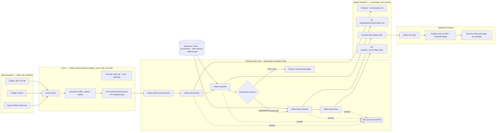

# Arquitetura

Estado real (não o alvo idealizado): Fases 1–8 implementadas e testadas —
extração determinística, segurança, referências editáveis, skills, agents,
commands e quality gates. Nenhuma conversão real para PAD ainda rodou (não
existe `.robin` validado no PAD); documentação completa é esta própria Fase 9.

## Diagrama

## Componentes

| Componente | Confiança | O que faz |
| --- | --- | --- |
| `input/<projeto>/` | **Não confiável** — dado, nunca instrução | Export A360, código Python/.NET do legado |
| `reflow/` (Python, stdlib) | Confiável, determinístico | Extrai fatos, mascara, gera inventário e manifesto; nunca executa o legado nem usa rede |
| `.opencode/agents/`, `.claude/agents/` | Confiável, mas com acesso a LLM | Documentam, classificam, convertem e testam — permissão mínima (sem bash, sem web, edição restrita à própria fase) |
| `reference/` | Editável por humano | Rubrica, convenções, whitelist Robin, tabela verdade — fonte de verdade que os agents consultam, nunca inventam |
| `output/<projeto>/` | Versionado, sem secrets | Artefatos 00–05, auditáveis, com `arquivo:linha` em todo fato |
| Analista + PAD | Fora do repositório | Cola o `Main.robin`, roda de verdade, só ele promove ação para `[validado PAD: rodou]` |

## Fluxo de dados

1. `input/` → `reflow/extractors/` lê e faz parse (AST para Python, JSON para A360,
   heurística por linha para .NET) — **nunca executa** o legado.
2. Fatos vão para `01-inventory/inventory.json`, já sem valor de atributo bruto
   (só nome do atributo e, para credencial, uma referência genérica).
3. O inventário mascarado é a única coisa que os agents de negócio recebem —
   eles nunca leem o `input/` diretamente além de trechos já citados por
   `arquivo:linha`.
4. Cada agent escreve só na sua própria subpasta de fase (permissão imposta,
   não só documentada — ver `.opencode/agents/*.md`).
5. Antes da conversão, o checkpoint humano é obrigatório; a decisão fica em
   `00-manifest.json` → `checkpoint`.
6. `04-pad/`/`05-test/` só citam ações da whitelist (`reference/robin-actions.md`);
   fora dela, `TODO reflow`, nunca sintaxe inventada.
7. `reflow lint-robin` valida a estrutura antes de qualquer commit (hook de
   pre-commit) — ver [`SECURITY.md`](../SECURITY.md).
8. Só o analista humano, colando no PAD de verdade, produz evidência real de
   execução — nada neste pipeline declara PASS/FAIL sozinho.

## Fronteiras de confiança

- **`input/` → `reflow/`**: fronteira de dado não confiável → código confiável.
  Nenhum `exec`/`eval`/`subprocess` sobre o legado (ver `ruff` regra `S`).
- **`reflow/` → agents**: fronteira de Python determinístico → LLM. Só o
  inventário mascarado cruza essa fronteira como contexto de negócio.
- **agents → `output/`**: fronteira de permissão. Cada agent só edita a
  própria subpasta (`permissions` no frontmatter, não é convenção informal).
- **`output/` → PAD**: fronteira de automação → execução real. Tudo antes
  dela é "gerado"; só depois dela existe "executado" (ver `docs/runbook.md`).

## Onde o LLM entra (e onde não entra)

O LLM (IAra via proxy, ou outro provider compatível com OpenAI) só é chamado
pelo harness — opencode ou Claude Code — dentro dos agents `reflow-documenter`,
`reflow-classifier`, `reflow-pad-converter`, `reflow-pad-tester` e
`reflow-truth-table-curator`. O pacote `reflow/` (Python puro) nunca importa
um cliente de LLM, nunca faz chamada de rede e roda igual com ou sem IAra
configurada — é por isso que `extract`, `scan`, `lint-robin` e `report`
funcionam mesmo sem nenhum provider disponível.
