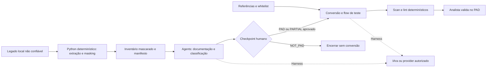

# Arquitetura alvo

Estado: esqueleto; componentes funcionais serão implementados nas próximas fases.

Somente o harness acessa o LLM. Python não usa rede nem executa o legado.
Nenhum diagrama preexistente foi alterado; a versão editável será avaliada na Fase 9.
