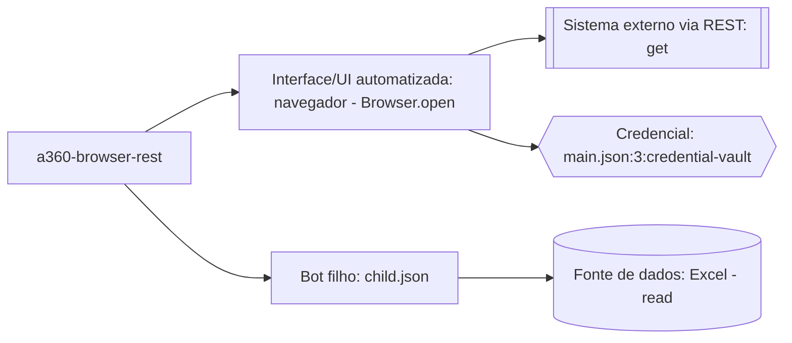

<!--
Gerado a partir de http_calls, data_sources, credentials e dependencies de
01-inventory/inventory.json. Rótulos citam o tipo, nunca o valor.
-->

# Arquitetura do projeto

## Legenda das integrações

| Nó | Evidência | Observação |
| --- | --- | --- |
| `UI` (navegador) | `main.json:1` | Abertura de página no navegador, ponto de partida do fluxo. |
| `HTTP` (REST get) | `main.json:2` | Chamada GET a um serviço externo via REST, feita a partir da página aberta. |
| `CRED` (Credential Vault) | `main.json:3` | Referência à credencial `main.json:3:credential-vault`, obtida do Credential Vault do A360; nunca o valor armazenado. |
| `FILHO` (child.json) | `main.json:4` | Dependência resolvida do bot principal para o bot filho `child.json`. |
| `DADOS` (Excel) | `child.json:1` | Leitura de planilha Excel realizada pelo bot filho. |

<!-- Nenhum nó foi removido: todas as integrações do inventário (REST, credencial
     do Credential Vault, bot filho e fonte de dados Excel) têm evidência acima. -->
