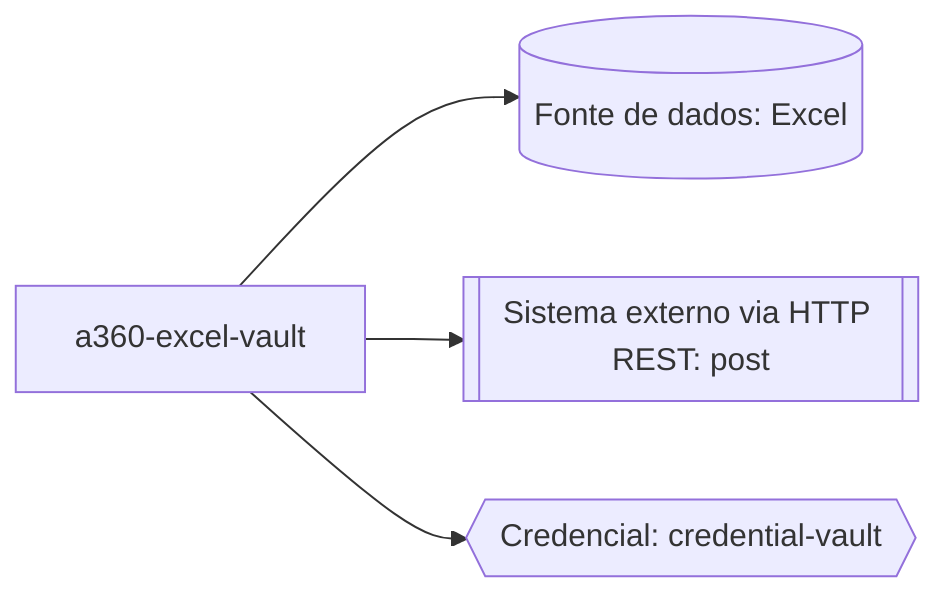

# Arquitetura do projeto

## Legenda das integrações

| Nó | Evidência | Observação |
| --- | --- | --- |
| `DADOS` (Excel) | `main.json:1`, `main.json:2` | Abertura (`open`) e leitura (`read`) de uma planilha Excel (`01-inventory/inventory.json:14-33`) |
| `HTTP` (REST post) | `main.json:3` | Envio de dados via requisição HTTP POST a um sistema externo, com corpo e cabeçalho de autorização (`01-inventory/inventory.json:38-49`) |
| `CRED` (credential-vault) | `main.json:4` | Credencial obtida do Cofre de Credenciais (`CredentialVault`) da Automation 360 para autenticar a integração HTTP (`01-inventory/inventory.json:2-13`) |

Não há nó de UI/interface automatizada neste diagrama porque `ui_interactions`
está vazio no inventário (`01-inventory/inventory.json:53`). Não há nó de bot
filho porque `dependencies` está vazio (`01-inventory/inventory.json:34`).

<!--
Os comandos `CustomPackage/transform` (`main.json:5`) e
`Browser/unmappedAction` (`main.json:6`), registrados em `unknown_commands`
(`01-inventory/inventory.json:54-69`), não foram representados como
integração neste diagrama: a extração não conseguiu classificar sua função,
e nenhuma integração foi presumida sem evidência. Ver `process-flow.md` para
o registro dessas pendências.
-->
