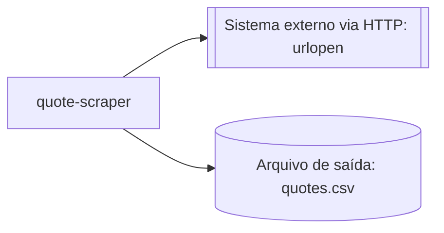

# Arquitetura do projeto

<!-- Nós removidos por falta de evidência no inventário: UI/Interface automatizada
     (ui_interactions vazio, 01-inventory/inventory.json:43), Credencial
     (credentials vazio, 01-inventory/inventory.json:2) e Bot filho (dependencies
     do inventário lista só bibliotecas Python, não outros bots). -->

## Legenda das integrações

| Nó | Evidência | Observação |
| --- | --- | --- |
| Sistema externo via HTTP: urlopen | `main.py:8` | Requisição HTTP para `https://example.invalid/quotes`, lida em seguida em `main.py:9` |
| Arquivo de saída: quotes.csv | `main.py:10-11` | Arquivo local aberto para escrita e usado para gravar o conteúdo obtido na requisição HTTP |
