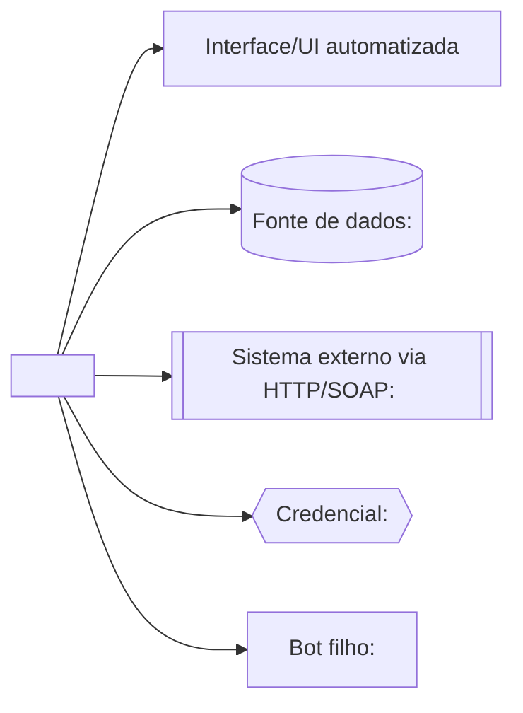

<!--
Template de 02-docs/architecture.md — atende ao pedido R3 da reunião (diagrama de
arquitetura por projeto, para identificar integrações). Um nó por sistema/fonte de
dados/credencial referenciada; rótulo cita o tipo, nunca o valor. Gere a partir de
http_calls, data_sources, credentials e dependencies do inventory.json.
-->

# Arquitetura do projeto

## Legenda das integrações

| Nó | Evidência | Observação |
| --- | --- | --- |
| `<sistema/fonte>` | `arquivo:linha` | [o que esse nó representa] |

<!-- Remova os nós que não se aplicarem a este projeto; não invente integração
     sem evidência no inventário. -->
